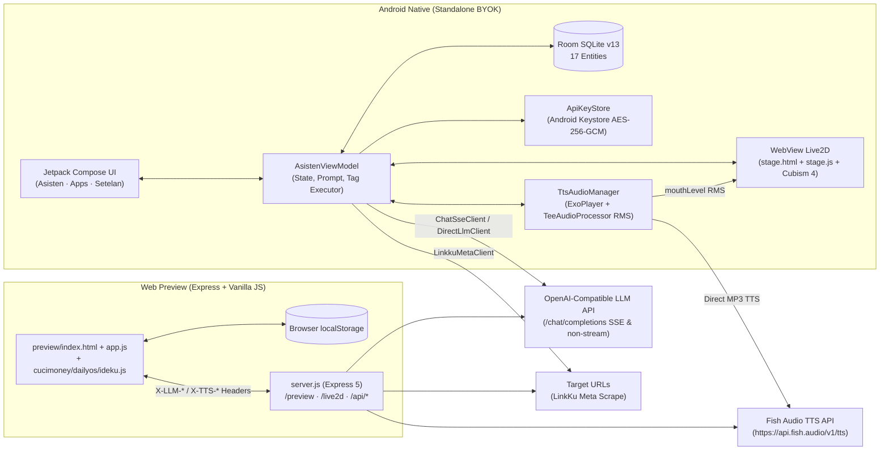

# EcosystemKu — Rem Assistant

**EcosystemKu (Rem Assistant)** adalah aplikasi asisten virtual pribadi berbasis karakter **Live2D (Cubism 4 — Rem)** yang terintegrasi penuh dengan **5 modul produktivitas lokal**: **Daily OS**, **CuciMoney+**, **IdeKu**, **Kronik**, dan **LinkKu**.

Proyek ini dibangun dengan arsitektur **Dual-Client (Feature-Parity)** yang saling mencerminkan:
1. **Android Native App (`android/`)**: Kotlin + Jetpack Compose + Material 3 + Room SQLite (v13) + WebView Live2D + ExoPlayer (Media3) — berjalan **100% standalone (BYOK / Bring Your Own Key)** langsung dari perangkat ke penyedia LLM & TTS.
2. **Web Preview & API Proxy (`preview/` + `server.js` + `api/`)**: Express 5 + Vanilla JS UI 3-tab (`Asisten`, `Apps`, `Setelan`) + `localStorage` untuk pengujian cepat di browser dengan proxy endpoint `/api/*`.

---

## Daftar Isi
- [Arsitektur Sistem](#arsitektur-sistem)
- [1. Asisten Virtual Rem & Pipeline Konteks](#1-asisten-virtual-rem--pipeline-konteks)
- [2. Live2D Stage, Lip-Sync, & Sistem Audio Anti-Bentrok](#2-live2d-stage-lip-sync--sistem-audio-anti-bentrok)
- [3. Protokol Tag Chat Rem](#3-protokol-tag-chat-rem)
- [4. Ekosistem 5 Sub-App Terintegrasi & Setelan](#4-ekosistem-5-sub-app-terintegrasi--setelan)
- [5. Skema Database Android (Room v13)](#5-skema-database-android-room-v13)
- [6. Endpoint Backend Web Preview (`/api/*`)](#6-endpoint-backend-web-preview-api)
- [7. Struktur Proyek](#7-struktur-proyek)
- [8. Tech Stack, Menjalankan Lokal, & CI/CD](#8-tech-stack-menjalankan-lokal--cicd)
- [9. Status Saat Ini & Arah Pengembangan Lanjutan](#9-status-saat-ini--arah-pengembangan-lanjutan)

---

## Arsitektur Sistem

Perbedaan paling penting yang perlu dipahami saat membaca kode repositori ini adalah **Android Native tidak bergantung pada `server.js` saat runtime**:



### Prinsip Desain Kunci
* **Bring Your Own Key (BYOK), Zero Hardcoded Secrets:** Tidak ada API key di repositori maupun backend default. Di Android, konfigurasi LLM & TTS disimpan terenkripsi **AES-256-GCM** di `AndroidKeyStore` (`ApiKeyStore.kt`). Di Web Preview, kredensial dikirim per-request lewat HTTP header `X-LLM-*` dan `X-TTS-*`.
* **`API_BASE_URL` di Android bersifat legacy:** Semua client jaringan Android (`ChatSseClient`, `DirectLlmClient`, `TtsAudioManager`, `MemoryClient`, `KronikMoodClient`, `IdekuAiClient`, `DailyOsAiClient`, `LinkkuMetaClient`) berkomunikasi langsung ke endpoint tujuan; parameter `baseUrl = BuildConfig.API_BASE_URL` diberi `@Suppress("unused")`.
* **Shared Live2D Assets:** Folder `android/app/src/main/assets/live2d/` dipakai langsung oleh WebView Android dan di-mount oleh `server.js` pada route `/live2d`.
* **Local-First & Portable:** Seluruh data obrolan, memori, dan 5 modul produktivitas tersimpan lokal dan dapat di-export/import sebagai **Ecosystem ZIP v3** (termasuk enkripsi privat LinkKu berbasis PIN).

---

## 1. Asisten Virtual Rem & Pipeline Konteks

Di Android (`AsistenViewModel.kt`) maupun Web Preview (`preview/app.js`), setiap giliran chat melewati pipeline berikut:

### A. Penyusunan Prompt (`buildPersonalizedPrompt` / `buildPersonalizedSystemPrompt`)
Sebelum memanggil LLM, klien menyuntikkan konteks nyata secara berurutan:
1. **Persona Dasar (`remSystemPrompt` / `character.json`):** Aturan karakter Rem (memanggil pengguna `"Tuan"`, teks biasa tanpa Markdown `**`/`*`/`` ` `` dan tanpa *em dash* `—`, aturan modul, dan format tag tersembunyi).
2. **Konteks Waktu Lokal & Jeda Pesan:** Hari, tanggal, jam perangkat, kategori waktu (`pagi`/`siang`/`sore`/`malam`), serta durasi jeda sejak pesan user terakhir (`formatElapsedGapId`), sehingga Rem sadar jeda antar chat.
3. **Lapisan Memori 3-Tingkat:**
   * **Ringkasan Memori Naratif (`MemoryProfileData`):** Profil terstruktur per bagian yang disintesis di latar belakang oleh AI (`/api/memory/extract` atau `MemoryClient`).
   * **Memori Fakta Teratas (`user_memories`):** Hingga 20 fakta personal (`identitas`, `preferensi`, `kebiasaan`, `tujuan`, `catatan`).
   * **Ringkasan Sesi Lalu (`conversation_summaries`):** 3 ringkasan sesi terdahulu.
   * **Rolling Context Compaction (`rollingSummary` di `chat_sessions`):** Saat pesan dalam satu sesi melebihi 10 pesan, pesan lama dipadatkan secara inkremental agar percakapan panjang tetap nyambung tanpa membengkakkan token.
4. **Ringkasan Live 5 Sub-App:**
   * **Daily OS:** Status habit hari ini, daftar to-do aktif/prioritas.
   * **CuciMoney+:** Daftar buku, akun beserta saldo saat ini, daftar kategori pemasukan & pengeluaran resmi (agar LLM memilih/menawarkan opsi kategori valid), breakdown pemasukan & pengeluaran bulan berjalan per kategori, status Master Budget bulanan, dan daftar tabungan Wishlist beserta progres nominalnya.
   * **IdeKu:** Daftar ide & wishlist aktif.
   * **Kronik:** 3 entri jurnal terbaru yang tidak diarsipkan.
   * **LinkKu:** 4 bookmark publik terbaru (bookmark privat tidak disuntikkan ke prompt).

### B. Eksekusi Multi-Putaran & On-Demand Archive Search (2-Tahap)
1. **Round 0..2 Loop (`streamAssistantReply`):** Klien mengirim maksimal 10 pesan terakhir + `personalizedPrompt` via SSE (`/chat/completions` dengan `stream = true`). Selama streaming, `SseTagParser.visibleTextDuringStream` menyembunyikan tag internal (`[...]`, `[JA]...[/JA]`) dari UI.
2. **Pencarian Arsip Lokal (`[SEARCH:scope|query]`):** Jika jawaban membutuhkan data lama yang tidak ada di ringkasan prompt (mis. transaksi bulan tertentu, jurnal lama, ide, bookmark publik, Daily OS, atau isi chat sesi lalu), Rem mengeluarkan `[SEARCH:scope|query]`. Klien mengeksekusi query lokal (`executeLocalArchiveSearch`), memutar klip tunggu `ack_2.mp3`, lalu menjalankan putaran LLM berikutnya dengan hasil pencarian tersebut (maksimal 2 putaran search per giliran).
3. **Finalisasi Tag & Pembaruan Modul:** `SseTagParser.parseFinal` memisahkan teks bersih, `[EXPR:...]`, `[CHOICES:...]`, `[OPEN:...]`, tag aksi modul (`MEMORY`, `KRONIK`, `LINKKU`, `CUCI`, `IDEKU`, `DAILYOS`), dan `[JA]...[/JA]`.
4. **Post-Reply Background Tasks:** Jika `autoLearnMemory` aktif, `extractAndPersistMemories` mengekstrak fakta baru ke SQLite dan memperbarui `MemoryProfileData`; lalu `compactSessionIfNeeded` memadatkan riwayat lama bila pesan sesi > 10.

### C. Manajemen Sesi, Kontrol Pesan, & Quick Replies
* **Multi-Sesi & Log Obrolan:** Mendukung buat sesi baru (**Obrolan Baru**), pindah sesi, ubah judul sesi, hapus sesi, serta **Smart Auto-Rollover** (otomatis membuat sesi baru saat pergantian hari atau jeda >= 5 jam jika sesi sebelumnya sudah berisi percakapan).
* **Aksi per Bubble Pesan:** Salin pesan, **Ulangi Jawaban** (*regenerate*), dan **Hapus Pesan** (tekan lama pada bubble di Android / tombol aksi di Web Preview).
* **Quick Replies (`[CHOICES:...]`):** Kartu pilihan interaktif di bawah pesan Rem:
  * `single`: tap satu chip langsung mengirim pilihan sebagai pesan balasan (mis. pilih buku *Personal*/*Bisnis*, pilih kategori CuciMoney+, pilih wishlist, atau konfirmasi).
  * `multi`: daftar centang multi-opsi dengan tombol **Kirim**.
* **Input Suara Custom Rem (`RemVoiceInputDialog`):** Pengenalan suara berbasis Android `SpeechRecognizer` (`id-ID`) dengan dialog custom ber-avatar Rem, animasi ring RMS real-time, transkrip parsial langsung, serta fallback ke `RecognizerIntent` sistem jika diperlukan.

---

## 2. Live2D Stage, Lip-Sync, & Sistem Audio Anti-Bentrok

### A. Live2D Cubism 4 (`stage.html` & `stage.js`)
* Dirender di dalam WebView transparan memakai `PIXI.live2d` (`cubism4.min.js` + `live2dcubismcore.min.js`) dengan konfigurasi model `android/app/src/main/assets/live2d/characters/rem/Character.model3.json`.
* Mendukung **14 ekspresi & motion** (`happy`, `smile`, `shame`, `sad`, `cry`, `angry`, `surprise`, `serious`, `proud`, `doubt`, `puzzle`, `upset`, `appeal`, `none`/`idle`) lengkap dengan mapping pose tangan (`REM_HAND_MAP`), urutan layer lengan (`REM_ARM_ORDER_MAP`), kedip mata alami, pernapasan idle, pelacakan arah sentuhan/kursor, *auto-revert* ekspresi ke `none` setelah 6 detik, serta custom **Wallpaper Stage** dengan pengaturan tingkat gelap (*dim*).
* **Interaksi Sentuh & Idle:** Tap area `head`, `body`, `leg`, gesture mengusap (`pet`), dan pengingat diam (*idle timer* 30 detik) memicu bubble teks lokal + klip suara bawaan + ekspresi.
* **Lip-Sync Real-Time:** `TtsAudioManager` memasang `TeeAudioProcessor` pada `ExoPlayer` untuk menghitung RMS level PCM audio secara real-time, lalu mengirim `stageController.setMouthOpen(level, isSpeaking)` ke WebView pada ~30 fps.

### B. Sistem Audio Ganda & Voice Klip Kontekstual
Klien memadukan dua jalur suara dalam satu kontrol yang tidak saling mematikan secara keliru:
1. **Dynamic Fish Audio TTS:** Membacakan teks `[JA]...[/JA]` (atau menerjemahkan teks Indonesia ke Jepang lewat `DirectLlmClient` / `/api/tts` jika tag `[JA]` tidak ada), dipecah per kalimat (`splitForTts`, maksimal 4 chunk, batas 500 karakter).
2. **Bundled Character Voice Clips (`assets/live2d/characters/rem/audio/`, 43 file `.mp3`):**
   * **24 Klip Tap/Idle:** `idle_1..7.mp3`, `head_1..5.mp3`, `pet_1..5.mp3`, `body_1..4.mp3`, `leg_1..3.mp3`.
   * **19 Klip Reaksi Obrolan Otomatis:** `ack_1..2.mp3`, `action_done_1..2.mp3`, `action_wishlist_1.mp3`, `greet_morning/afternoon/night.mp3`, `thanks_1.mp3`, `goodnight_1.mp3`, `chat_happy_1.mp3`, `chat_proud_1.mp3`, `chat_serious_1.mp3`, `chat_sad_1.mp3`, `chat_surprise_1.mp3`, `chat_puzzle_1.mp3`, `chat_shame_1.mp3`, `chat_smile_1..2.mp3`.
3. **Mekanisme Anti-Bentrok & Mute Independen (`TtsAudioManager.kt`):**
   * **Mute Terpisah:** `isTtsMuted` (tombol speaker & menu **"Matikan Suara TTS"**) dan `isClipMuted` (menu **"Matikan Voice Klip"**) dipisah sehingga mematikan TTS AI tidak membungkam voice klip bawaan Rem.
   * **Auto-Fallback Cerdas:** `playTts(..., fallbackClip)` dan `playTTS(..., fallbackClip)` di Web Preview memilih klip kontekstual lewat `selectChatVoiceClip(...)` (prioritas: `[CUCI:REALIZE]` -> `action_wishlist_1`, aksi modul -> `action_done_1/2`, pamit/terima kasih/sapaan waktu -> `goodnight`/`thanks`/`greet_*`, konfirmasi singkat/`[OPEN]` -> `ack_1`, obrolan umum -> sesuai `[EXPR:...]`). Klip reaksi hanya diputar bila TTS dimatikan, `TTS_API_KEY` belum diisi, atau fetch TTS gagal, dan klip tap/idle tidak akan memutus fetch TTS yang sedang berjalan (`activeFetchJob`).

---

## 3. Protokol Tag Chat Rem

Respons LLM dapat menyertakan tag tersembunyi berikut (dibersihkan dari bubble chat saat streaming & finalisasi):

| Tag | Fungsi & Keterangan |
| --- | --- |
| `[SEARCH:scope\|kata_kunci]` | Pencarian on-demand 2-tahap ke arsip lokal (`kronik`, `linkku`, `cuci`, `ideku`, `dailyos`, `chat`, `all`) |
| `[CHOICES:single\|Opsi 1\|Opsi 2]` | Menampilkan chip pilihan tunggal di bawah pesan Rem (tap langsung kirim) |
| `[CHOICES:multi\|Opsi 1\|Opsi 2]` | Menampilkan daftar checkbox pilihan ganda + tombol **Kirim** |
| `[MEMORY:SET\|kategori\|fact_key\|nilai]` | Menyimpan atau memperbarui fakta memori personal dari obrolan |
| `[MEMORY:DEL\|fact_key_atau_kata_kunci]` | Menghapus/melupakan fakta memori personal |
| `[EXPR:nama]` | Mengubah ekspresi & motion Live2D (`happy`, `smile`, `shame`, `sad`, `cry`, `angry`, `surprise`, `serious`, `proud`, `doubt`, `puzzle`, `upset`, `appeal`, `navi`, `none`) |
| `[OPEN:app]` | Membuka overlay modul (`kronik`, `linkku`, `cucimoney`, `ideku`, `dailyos`) |
| `[KRONIK:ADD\|judul\|isi\|mood]` | Menambah entri jurnal baru ke Kronik |
| `[LINKKU:ADD\|url\|judul\|catatan\|kategori\|tag1,tag2]` | Menyimpan bookmark publik ke LinkKu + auto-fetch metadata URL |
| `[CUCI:ADD\|out/in\|nominal\|judul\|kategori\|akun]` | Mencatat transaksi pengeluaran/pemasukan ke CuciMoney+ (dukungan multi-buku & kategori resmi) |
| `[CUCI:SAVE\|nama_wishlist\|nominal\|akun_ops\|buku_ops]` | Menyetor tabungan ke pot tabungan wishlist (alias: `NABUNG`, `DEPOSIT`, `TABUNG`) |
| `[CUCI:REALIZE\|nama_wishlist\|akun_ops\|nominal_beli_ops\|buku_ops]` | Mencairkan tabungan / menandai wishlist sudah kebeli & sinkron status `"Selesai"` di IdeKu (alias: `BELI`, `DONE`, `SELESAI`, `CAIRKAN`) |
| `[IDEKU:ADD\|Idea\|judul\|kategori\|prioritas\|catatan\|jalur]` | Menambah ide baru ke IdeKu |
| `[IDEKU:ADD\|Wishlist\|nama\|harga\|Belanja\|prioritas\|catatan]` | Menambah wishlist ke IdeKu dan menyinkronkannya ke CuciMoney+ |
| `[DAILYOS:HABIT\|nama\|kategori\|ikon]` | Menambah habit baru di Daily OS |
| `[DAILYOS:TODO\|judul\|priority\|YYYY-MM-DD]` | Menambah tugas to-do di Daily OS (`urgent`, `soon`, `normal`) |
| `[DAILYOS:CHECK\|kata_kunci]` | Menandai habit atau to-do selesai hari ini |
| `[JA]...[/JA]` | Teks bahasa Jepang khusus untuk sintesis suara Fish Audio TTS |

---

## 4. Ekosistem 5 Sub-App Terintegrasi & Setelan

### 1. Daily OS (`dailyos/`)
* **Tabs (`DailyOsTab`):** `HABIT`, `TODO`, `STATS`, `AI`, `SETTINGS`.
* **Fitur:** Habit tracker harian (mendukung sub-task & `activeDaysJson` + log riwayat per tanggal), To-Do dengan prioritas (`urgent`, `soon`, `normal`), deadline, & sub-task, statistik konsistensi, notifikasi lokal terjadwal (`DailyOsNotificationHelper`), serta 4 mode AI (`coach` briefing harian, `memory` analisis tren 30 hari, `parse_todo` dari teks bebas, dan `recommend_todo`).

### 2. CuciMoney+ (`cucimoney/`)
* **Tabs (`CuciTab`):** `BUKU`, `DOMPET`, `ANALISIS` (`EXPENSE`, `INCOME`, `BUDGET`, `TREN`), `LAINNYA`, `TABUNGAN`.
* **Fitur:** Manajemen multi-buku (mis. *Personal*, *Bisnis*), multi-akun/dompet (termasuk pot tabungan khusus), transfer antar akun (`transferPair`), kategori pemasukan/pengeluaran (termasuk deteksi & saran chip kategori lewat Rem), *Master Budget* bulanan, dan tabungan Wishlist (setor tabungan, cairkan/batalkan, atau realisasi pembelian yang otomatis menandai item terkait di **IdeKu** sebagai `"Selesai"`).

### 3. IdeKu (`ideku/`)
* **Mode Tampilan (`IdekuViewMode`):** `GROUP`, `FLAT`, `GRID`.
* **Fitur:** Mengelola **Idea** (lengkap dengan kategori, prioritas, catatan, dan jalur eksekusi) dan **Wishlist** (dengan estimasi harga & sinkronisasi dua arah dengan `CuciWishlistEntity`). Dilengkapi fitur AI **Perkaya** (`mode: "perkaya"`) dan **Breakdown Prompt** (`mode: "breakdown"`).

### 4. Kronik (`kronik/`)
* **Fitur:** Buku jurnal pribadi (mendukung judul, isi markdown/plain, tanggal, pin entri, arsip entri, ekspor/impor JSON) dengan **7 status mood** (`Fokus`, `Lelah`, `Terinspirasi`, `Berat`, `Stabil`, `Semangat`, `Kabur`) beserta deteksi mood otomatis berbasis AI.

### 5. LinkKu (`linkku/`)
* **Fitur:** Pengelola bookmark dengan kategori, tag bebas, auto-fetch judul & `og:image`/thumbnail YouTube (`LinkkuMetaClient` / `/api/linkku/meta` dengan proteksi SSRF blocklist IP privat di server), serta **Mode Privat ber-PIN 4-digit** yang mengenkripsi payload privat menggunakan **PBKDF2 (100.000 iterasi, `linkku-salt-v1`) + AES-GCM** (`LinkkuCrypto`).

### 6. Setelan & Backup Ecosystem ZIP v3 (`SetelanScreen.kt`)
* **Profil & Konfigurasi AI:** Nama panggilan pengguna, input & uji koneksi LLM + Fish Audio TTS (disimpan terenkripsi di `ApiKeyStore`).
* **Manajemen Memori:** Lihat, tambah/ubah/hapus `user_memories`, aktifkan/matikan *auto-learn memory*, serta perbarui/hapus **Ringkasan Memori** naratif.
* **Tampilan & Stage:** Mode tema (`system` / `light` / `dark`), pemilihan gambar **Wallpaper Rem** dari galeri + slider *dim* latar belakang, dan reset stage.
* **Export / Import ZIP v3 (`EcosystemManifestDto`):** Ekspor seluruh data (chat sessions, memori, Daily OS, CuciMoney+, IdeKu, Kronik, LinkKu) ke satu arsip `.zip` dan impor kembali dengan mode **Merge** atau **Replace** (termasuk dialog dekripsi PIN untuk tautan privat LinkKu). *(Catatan: tombol `Cloud Backup (Google Drive)` saat ini masih berupa placeholder `Segera Hadir (v1.1)`).*

---

## 5. Skema Database Android (Room v13)

`AssistantDatabase` (`version = 13`, `exportSchema = false`) mengelola **17 Entity** dalam satu SQLite lokal dengan migrasi eksplisit `MIGRATION_1_2` hingga `MIGRATION_12_13`:

| Domain | Entity | Peran Utama |
| --- | --- | --- |
| **Chat & Memori** | `ChatSessionEntity` | Sesi obrolan (`id`, `title`, `rollingSummary`, `createdAt`, `updatedAt`) |
| | `ChatMessageEntity` | Pesan per sesi (`role`, `content`, `expressionTag`, `choicesJson`, `createdAt`) |
| | `UserMemoryEntity` | Fakta personal unik berdasarkan `factKey`, kategori, dan `confidence` |
| | `ConversationSummaryEntity` | Ringkasan sesi percakapan terdahulu |
| **Kronik** | `KronikEntryEntity` | Entri jurnal, pin, arsip, `moodStatus`, `moodSvgKey`, `habitsLogJson` |
| **LinkKu** | `LinkkuLinkEntity` | URL, judul, catatan, kategori, `tagsJson`, `isPrivate`, `thumb` |
| | `LinkkuCategoryEntity` | Kategori publik & privat LinkKu |
| **CuciMoney+** | `CuciBookEntity` | Buku kas terpisah |
| | `CuciAccountEntity` | Akun/dompet, saldo, flag `isSavings` |
| | `CuciCategoryEntity` | Kategori transaksi (`income` / `expense` / `both`) |
| | `CuciMemberEntity` | Anggota buku kas |
| | `CuciTransactionEntity` | Transaksi masuk/keluar, `transferPair`, dan `savingsPot` |
| | `CuciMasterBudgetEntity` | Target budget per bulan & kategori |
| | `CuciWishlistEntity` | Target wishlist, tabungan terkumpul (`saved`), status, & realisasi |
| **IdeKu** | `IdekuIdeaEntity` | Ide & wishlist (`type`, `priority`, `status`, `price`, `jalur`) |
| **Daily OS** | `DailyOsHabitEntity` | Habit, jadwal aktif, sub-tasks JSON, & history JSON |
| | `DailyOsTodoEntity` | To-do, prioritas, deadline, status selesai, & sub-tasks JSON |

---

## 6. Endpoint Backend Web Preview (`/api/*`)

Digunakan oleh **Web Preview** (`server.js` pada port `3000` atau `process.env.PORT`). Klien mengirim kredensial lewat header `X-LLM-Base`, `X-LLM-Model`, `X-LLM-Key`, `X-TTS-Key`, `X-TTS-Base`, `X-TTS-Model`, `X-TTS-Voice`:

| Method & Route | Handler | Input & Fungsi |
| --- | --- | --- |
| `POST /api/chat` | `api/chat.js` | `{ messages, context }` — Streaming SSE (`event: delta`, `done`, `error`), menyisipkan aturan `[JA]...[/JA]` & memisahkan teks display vs TTS |
| `POST /api/memory/extract` | `api/memory.js` | `{ mode, messages, existingFacts, facts, summaries, previousSummary }` — Ekstraksi fakta memori, sintesis `MemoryProfile`, atau `compact_session` untuk `rollingSummary` |
| `POST /api/dailyos` | `api/dailyos.js` | `{ mode: "coach" \| "memory" \| "parse_todo" \| "recommend_todo", ... }` — AI Coach & otomasi tugas Daily OS |
| `POST /api/ideku` | `api/ideku.js` | `{ title, notes, category, priority, mode: "perkaya" \| "breakdown" }` — Perkaya ide atau breakdown langkah/prompt |
| `POST /api/kronik/mood` | `api/kronikMood.js` | `{ text }` — Klasifikasi ke salah satu dari 7 mood resmi Kronik |
| `POST /api/linkku/meta` | `api/linkkuMeta.js` | `{ url }` — Fetch `<title>` & `og:image` URL (memblokir host lokal/IP privat) |
| `POST /api/tts` | `api/tts.js` | `{ text, translated }` — Sintesis MP3 via Fish Audio (`s2.1-pro-free` default); menerjemahkan ke Jepang terlebih dulu bila `translated = false` |
| `GET /` & `/preview/*` | `server.js` | Web Preview UI non-PWA (cache disabled via `no-store`) |
| `GET /live2d/*` | `server.js` | Static mount ke `android/app/src/main/assets/live2d/` |

---

## 7. Struktur Proyek

```text
.
├── server.js                          # Express 5 server: CORS, /api/* routes, /live2d, & Web Preview
├── package.json                       # Dependencies & scripts (dev, build, start, lint)
├── api/                               # Serverless-style route handlers untuk Web Preview
│   ├── _llm.js                        # Resolver header X-LLM-* & helper URL /chat/completions
│   ├── chat.js                        # SSE streaming chat + pemisah [JA]...[/JA]
│   ├── dailyos.js                     # AI Coach, 30d memory, parse_todo, recommend_todo
│   ├── ideku.js                       # Perkaya & breakdown ide
│   ├── kronikMood.js                  # Deteksi 7 mood jurnal Kronik
│   ├── linkkuMeta.js                  # Scraper metadata URL + proteksi SSRF
│   ├── memory.js                      # Ekstraksi fakta, sintesis profil, & compact_session
│   └── tts.js                         # Proxy Fish Audio TTS MP3
├── preview/                           # Web Preview (UI 3-tab pencerminan Android)
│   ├── index.html                     # Layout & dialog Web Preview
│   ├── app.js                         # Live2D, chat, memori, rolling compaction, & tag executor
│   ├── cucimoney.js / .css            # Logika & UI CuciMoney+ di web
│   ├── dailyos.js / .css              # Logika & UI Daily OS di web
│   └── ideku.js / .css                # Logika & UI IdeKu di web
├── android/                           # Proyek Android Native (compileSdk 35, targetSdk 35, minSdk 26)
│   ├── gradle/ & build.gradle.kts     # Konfigurasi Gradle 8.9
│   └── app/
│       ├── build.gradle.kts           # Jetpack Compose, Room + KSP, Media3 ExoPlayer, OkHttp SSE, signing "fixed"
│       ├── rem-assistant.jks          # Fixed debug/release keystore agar update APK menimpa versi lama
│       └── src/main/
│           ├── assets/live2d/         # stage.html, stage.js, vendor Cubism4/Pixi, model Rem + 43 audio .mp3
│           └── java/com/ecosystemku/assistant/
│               ├── EcosystemKuApp.kt & MainActivity.kt & CrashActivity.kt
│               ├── data/audio/        # TtsAudioManager (ExoPlayer + RMS lip-sync + mute terpisah)
│               ├── data/local/        # AssistantDatabase (v13), ApiKeyStore, Entities & DAOs
│               ├── data/network/      # ChatSseClient, DirectLlmClient, SseTagParser, & *Client modul
│               ├── live2d/            # Live2DStageController (JS <-> Kotlin bridge)
│               ├── notifications/     # DailyOsNotificationHelper
│               └── ui/
│                   ├── asisten/       # AsistenScreen, RemVoiceInputDialog, & AsistenViewModel (otak ekosistem)
│                   ├── apps/          # AppsHubScreen + cucimoney/, dailyos/, ideku/, kronik/, linkku/
│                   ├── navigation/    # BottomNavBar (Asisten, Apps, Setelan)
│                   ├── setelan/       # SetelanScreen (AI config, memori, tema, wallpaper, ZIP v3)
│                   └── theme/         # Color, Theme, Type (EditorialSerif & UiSans)
└── .github/workflows/
    └── android-apk.yml                # GitHub Actions CI: JDK 17, Android SDK 35, Gradle 8.9 -> Artifact APK
```

---

## 8. Tech Stack, Menjalankan Lokal, & CI/CD

### Tech Stack Utama
* **Android:** Kotlin, Jetpack Compose BOM, Material 3, Room + KSP (`v13`), Media3 ExoPlayer (`1.x`), OkHttp + OkHttp-SSE, Kotlinx Serialization, AndroidX WebKit, Android Keystore (`AES/GCM/NoPadding`).
* **Web & Backend:** Node.js (ESM), Express `^5.3.0`, `@google/genai`, Vanilla JavaScript + HTML/CSS di `preview/`, `PIXI.live2d` + Cubism 4 Core. *(Catatan: `package.json` juga mencantumkan dependensi Next/React/Tailwind di manifest root, namun runtime preview aktif saat ini dijalankan lewat `server.js` + `preview/`.)*

### Menjalankan Backend & Web Preview
```bash
npm install
npm start
```
Server berjalan di `http://0.0.0.0:3000` (atau sesuai `PORT` environment variable):
* Web Preview: `http://localhost:3000/` atau `http://localhost:3000/preview/`
* Aset Live2D: `http://localhost:3000/live2d/`

Pengecekan sintaks & lint:
```bash
npm run build
npm run lint
```

### Build Android APK Lokal & CI
* **Lokal:** Buka folder `android/` di Android Studio atau jalankan Gradle Wrapper/Gradle 8.9 dengan JDK 17:
  ```bash
  cd android
  gradle :app:assembleDebug --no-daemon --stacktrace
  ```
  Output APK: `android/app/build/outputs/apk/debug/app-debug.apk` (memakai `signingConfig` `"fixed"` dari `android/app/rem-assistant.jks` agar instalasi APK baru selalu menimpa versi sebelumnya tanpa uninstall).
* **CI/CD GitHub Actions (`.github/workflows/android-apk.yml`):** Otomatis berjalan setiap `push` ke branch `main` (dan mendukung `workflow_dispatch`), membangun Debug APK dengan JDK 17 + Android SDK 35 + Gradle 8.9, lalu mengunggah artifact `Asisten-Rem-debug-apk` (retensi 30 hari).

---

## 9. Status Saat Ini & Arah Pengembangan Lanjutan

Bagian ini merangkum posisi proyek saat ini sebagai konteks bagi kontributor atau AI lain yang meninjau kode:

### Yang Sudah Berjalan Baik
* Arsitektur standalone BYOK Android dengan enkripsi key lokal, streaming SSE, dan fallback suara berlapis (Fish Audio TTS -> Voice Klip kontekstual sesuai aksi/ekspresi).
* Sinkronisasi dua arah antara percakapan Rem dan 5 modul produktivitas (termasuk `[SEARCH:...]` arsip lokal 2-tahap, `[CHOICES:...]`, rolling context compaction, dan realisasi wishlist CuciMoney+ <-> IdeKu).
* Backup/Restore portabel lintas-modul via ZIP v3.

### Area Terbuka & Kandidat Pengembangan Berikutnya
1. **Automated Testing:** Belum ada unit test/instrumentation test (`android/app/src/test`, `androidTest`, maupun suite test API Node) — kandidat prioritas adalah unit test untuk `SseTagParser`, `CuciMoney` saldo/realisasi wishlist, `LinkkuCrypto`, dan migrasi Room.
2. **Modularisasi `AsistenViewModel.kt`:** Saat ini `AsistenViewModel.kt` (~4.300+ baris) menampung hampir seluruh orkestrasi AI, prompt builder, tag executor, backup ZIP, dan action 5 sub-app dalam satu kelas; memecahnya menjadi repository/use-case per modul akan sangat meningkatkan keterbacaan dan testability.
3. **Cloud Backup (Google Drive `v1.1`):** Saat ini masih berupa tombol non-aktif (*placeholder*) di `SetelanScreen.kt`.
4. **Voice Interaction Dua Arah & TTS Fallback Sistem:** Menambah mode percakapan hands-free (STT mic kontinu) serta opsi Android `TextToSpeech` lokal sebagai opsi tambahan di luar Fish Audio & voice klip bawaan.
5. **Pembersihan Legacy:** Menghapus parameter `API_BASE_URL` yang sudah tidak terpakai (`@Suppress("unused")`) di client jaringan Android dan merapikan dependensi React/Next di `package.json` root bila memang tidak digunakan.
