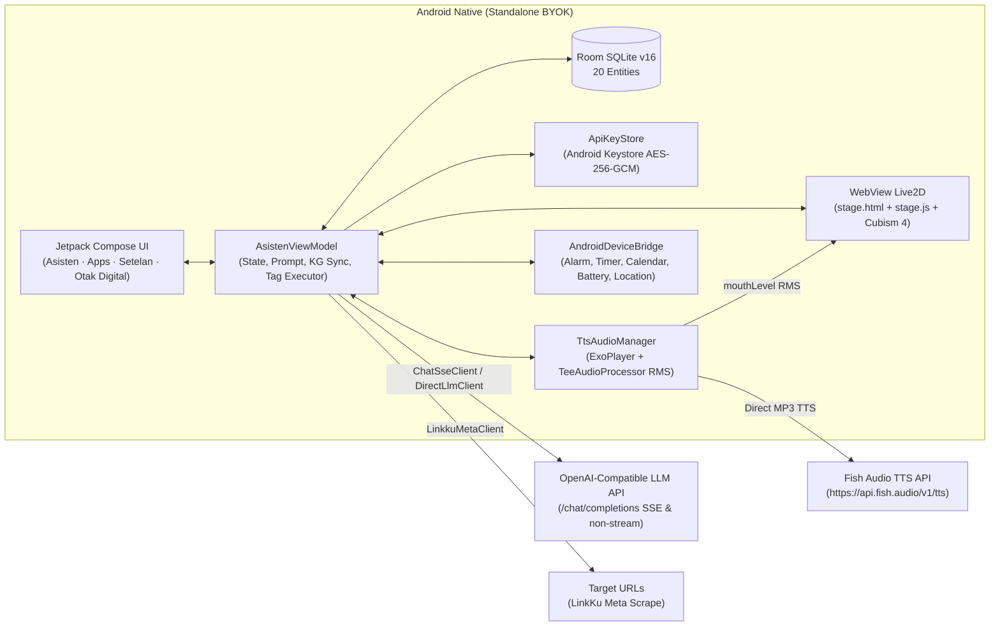

# EcosystemKu — Rem Assistant (Android)

**EcosystemKu (Rem Assistant)** adalah aplikasi **Android Native** berbasis karakter **Live2D (Cubism 4 — Rem)** yang terintegrasi penuh dengan **5 modul produktivitas lokal**: **Daily OS**, **CuciMoney+**, **IdeKu**, **Kronik**, dan **LinkKu**.

Repositori ini difokuskan **100% pada aplikasi Android (`android/`)**:
* **Android Native App (`android/`):** Kotlin + Jetpack Compose + Material 3 + Room SQLite (v16) + WebView Live2D + ExoPlayer (Media3) — berjalan **100% standalone (BYOK / Bring Your Own Key)** langsung dari perangkat ke penyedia LLM & TTS.

---

## Daftar Isi
- [Arsitektur Sistem](#arsitektur-sistem)
- [1. Asisten Virtual Rem & Pipeline Konteks](#1-asisten-virtual-rem--pipeline-konteks)
- [2. Live2D Stage, Lip-Sync, & Sistem Audio Anti-Bentrok](#2-live2d-stage-lip-sync--sistem-audio-anti-bentrok)
- [3. Protokol Tag Chat Rem](#3-protokol-tag-chat-rem)
- [4. Ekosistem 5 Sub-App Terintegrasi & Setelan](#4-ekosistem-5-sub-app-terintegrasi--setelan)
- [5. Skema Database Android (Room v16)](#5-skema-database-android-room-v16)
- [6. Struktur Proyek](#6-struktur-proyek)
- [7. Tech Stack, Build APK, & CI/CD](#7-tech-stack-build-apk--cicd)
- [8. Status Saat Ini & Arah Pengembangan Lanjutan](#8-status-saat-ini--arah-pengembangan-lanjutan)

---

## Arsitektur Sistem

Aplikasi Android bersifat **standalone** dan berkomunikasi langsung dengan endpoint API pilihan pengguna tanpa server perantara:



### Prinsip Desain Kunci
* **Bring Your Own Key (BYOK), Zero Hardcoded Secrets:** Tidak ada API key bawaan di repositori. Konfigurasi LLM & TTS disimpan terenkripsi **AES-256-GCM** di `AndroidKeyStore` (`ApiKeyStore.kt`).
* **`API_BASE_URL` bersifat legacy:** Semua client jaringan Android (`ChatSseClient`, `DirectLlmClient`, `TtsAudioManager`, `MemoryClient`, `KronikMoodClient`, `IdekuAiClient`, `DailyOsAiClient`, `LinkkuMetaClient`) berkomunikasi langsung ke endpoint tujuan; parameter `baseUrl = BuildConfig.API_BASE_URL` diberi `@Suppress("unused")`.
* **WebView Khusus Stage Live2D:** Seluruh UI aplikasi memakai Jetpack Compose; WebView hanya dipakai transparan di layer stage untuk merender aset `android/app/src/main/assets/live2d/`.
* **Local-First & Portable:** Seluruh data obrolan, memori, dan 5 modul produktivitas tersimpan lokal di SQLite dan dapat di-export/import sebagai **Ecosystem ZIP v3** (termasuk enkripsi privat LinkKu berbasis PIN).

---

## 1. Asisten Virtual Rem & Pipeline Konteks

Di [`AsistenViewModel.kt`](android/app/src/main/java/com/ecosystemku/assistant/ui/asisten/AsistenViewModel.kt), setiap giliran chat melewati pipeline berikut:

### A. Penyusunan Prompt (`buildPersonalizedPrompt`)
Sebelum memanggil LLM, klien menyuntikkan konteks nyata secara berurutan:
1. **Persona Dasar:** Aturan karakter Rem (memanggil pengguna `"Tuan"`, teks biasa tanpa Markdown `**`/`*`/`` ` `` dan tanpa *em dash* `—`, aturan modul, dan format tag tersembunyi).
2. **Konteks Waktu Lokal & Jeda Pesan:** Hari, tanggal, jam perangkat, kategori waktu (`pagi`/`siang`/`sore`/`malam`), serta durasi jeda sejak pesan user terakhir (`formatElapsedGapId`), sehingga Rem sadar jeda antar chat.
3. **Lapisan Memori 4-Tingkat + Knowledge Graph ("Otak Digital"):**
   * **Ringkasan Memori Naratif (`MemoryProfileData`):** Profil terstruktur per bagian yang disintesis di latar belakang oleh `MemoryClient`, serta dapat diedit/ditambah/dihapus manual (dilindungi flag `manuallyEdited` agar pembaruan otomatis tidak menimpa editan user).
   * **Personal Knowledge Graph ("Otak Digital" — `kg_nodes` & `kg_edges`):** Peta graf relasional berbobot (`SELF`, `NILAI`, `POLA_PIKIR`, `KEBIASAAN`, `TUJUAN`, `EMOSI_PEMICU`, `KEPUTUSAN`, `MINAT`, `ORANG`, `KONTEKS`) beserta relasi policy/kausal (`MENYEBABKAN`, `BERTENTANGAN`, `MEMOTIVASI`, `CONTOH_DARI`, `MENGGANTIKAN`). Sistem mengambil hingga 14 relasi **aktif** paling relevan ke prompt setiap giliran (`queryContextForMessage`), menyimpan metadata sumber (`sourceType`, `sourceRef`), tanggal dibuat/konfirmasi (`firstSeenAt`, `lastConfirmedAt`), `confidence`, `validationState`, dan status `active`/`deprecated`/`compacted`. Saat fakta serupa ditegaskan ulang, sistem memperkuat `confidence` dan `lastConfirmedAt` lewat pencocokan semantik (`findSimilarActiveNode`) tanpa membuat simpul duplikat; simpul `deprecated` berusia >90 hari dapat dipadatkan berkala menjadi ringkasan riwayat (`compactOldDeprecatedNodes`) dengan **tetap menjaga simpul `SELF` dan `NILAI` secara utuh**.
   * **Memori Fakta Teratas (`user_memories`):** Hingga 20 fakta personal aktif (`identitas`, `preferensi`, `kebiasaan`, `tujuan`, `catatan`), dengan pelestarian riwayat saat fakta berubah atau ditandai usang.
   * **Ringkasan Sesi Lalu (`conversation_summaries`):** 3 ringkasan sesi terdahulu.
   * **Rolling Context Compaction (`rollingSummary` di `chat_sessions`):** Saat pesan dalam satu sesi melebihi 10 pesan, pesan lama dipadatkan secara inkremental agar percakapan panjang tetap nyambung tanpa membengkakkan token.
4. **Mode Keahlian Adaptif (`RemSkillRegistry`):** Jika `skillsEnabled` aktif, `RemSkillSelector` memilih maksimal 1 panduan keahlian dari `assets/skills/` (`digital-twin-interviewer`, `cucimoney-financial-advisor`, `kronik-reflection-therapist`, `ideku-execution-strategist`, `weekly-life-review`) hanya saat konteks/pesan membutuhkannya (0 token tambahan pada obrolan biasa).
5. **Ringkasan Live 5 Sub-App:**
   * **Daily OS:** Status habit hari ini, streak berturut-turut per-habit (`calculateHabitStreak`) & overall streak, daftar to-do aktif/prioritas & selesai terbaru (beserta ID).
   * **CuciMoney+:** Daftar buku, akun beserta saldo saat ini, daftar kategori pemasukan & pengeluaran resmi, seluruh breakdown pemasukan & pengeluaran bulan berjalan per kategori, 5 transaksi terakhir (beserta ID), status Master Budget bulanan, dan ringkasan saldo total pot tabungan Wishlist.
   * **IdeKu & Wishlist (Terpisah):** Bagian **Daftar Ide** (`Fokus Proses`, `Idea Belum` hingga 20 item, `Idea Parkir` hingga 10 item) terpisah tegas dari bagian **Daftar Wishlist** (digabungkan dengan progres pot tabungan CuciMoney+), dengan label `[Tipe=... | Status=... | Prioritas=...]` di setiap item.
   * **Kronik:** Ringkasan hemat-token: 2 entri terbaru secara ringkas + hingga 3 entri aktif yang paling relevan dengan topik chat/simpul Otak Digital saat ini (entri lain diakses via `[SEARCH:kronik|...]`).
   * **LinkKu:** 4 bookmark publik terbaru (bookmark privat tidak disuntikkan ke prompt).
6. **Batasan Keamanan & Privasi Chat:** Rem **tidak memiliki akses browsing internet bebas** di dalam chat dan **tidak dapat mengirim pesan (WhatsApp/SMS/email) atas nama pengguna**; aksi eksternal dibatasi pada `Intent` Android eksplisit (`OPEN_URL`, `SHARE`, alarm, kalender) yang membutuhkan konfirmasi/interaksi pengguna di layar sistem.

### B. Eksekusi Multi-Putaran & On-Demand Archive Search (2-Tahap)
1. **Round 0..2 Loop (`streamAssistantReply`):** Klien mengirim maksimal 10 pesan terakhir + `personalizedPrompt` via SSE (`/chat/completions` dengan `stream = true`). Selama streaming, `SseTagParser.visibleTextDuringStream` menyembunyikan tag internal (`[...]`, `[JA]...[/JA]`) dari UI.
2. **Pencarian Arsip Lokal (`[SEARCH:scope|query]`):** Jika jawaban membutuhkan data lama, filter khusus, relasi Knowledge Graph, atau info perangkat yang tidak ada di ringkasan prompt (mis. transaksi bulan/kategori tertentu via `book=...;month=...;from=...;to=...;cat=...;acc=...;dir=...;q=...`, riwayat tanggal & streak habit, jurnal lama, ide, bookmark publik, isi chat sesi lalu, simpul/relasi `kg`, atau status baterai/kalender/lokasi/pengingat), Rem mengeluarkan `[SEARCH:scope|query]`. Klien mengeksekusi query lokal (`executeLocalArchiveSearch`), memutar klip tunggu `ack_2.mp3`, lalu menjalankan putaran LLM berikutnya dengan hasil pencarian tersebut (maksimal 2 putaran search per giliran).
3. **Finalisasi Tag & Pembaruan Modul:** `SseTagParser.parseFinal` memisahkan teks bersih, `[EXPR:...]`, `[CHOICES:...]`, `[OPEN:...]`, tag aksi modul (`MEMORY`, `KG`, `DEVICE`, `KRONIK`, `LINKKU`, `CUCI`, `IDEKU`, `DAILYOS`), dan `[JA]...[/JA]`.
4. **Post-Reply Background Tasks:** Jika `autoLearnMemory` aktif, `extractAndPersistMemories` membaca petunjuk simpul aktif (`getActiveNodeHints`), mengekstrak fakta baru (`user_memories`) beserta triple Knowledge Graph antarsimpul (`kg_nodes`/`kg_edges`) ke SQLite, menjalankan sinkronisasi sinyal perilaku 0-token (`BehavioralSignalSync` lintas modul termasuk relasi non-`SELF` `MEMOTIVASI`/`MENDUKUNG`), pemadatan berkala mingguan (`compactOldDeprecatedNodes`), serta memperbarui `MemoryProfileData` (kecuali bila `manuallyEdited == true`); lalu `compactSessionIfNeeded` memadatkan riwayat lama bila pesan sesi > 10.

### C. Manajemen Sesi, Kontrol Pesan, & Quick Replies
* **Multi-Sesi & Log Obrolan:** Mendukung buat sesi baru (**Obrolan Baru**), pindah sesi, ubah judul sesi, hapus sesi, serta **Smart Auto-Rollover** (otomatis membuat sesi baru saat pergantian hari atau jeda >= 5 jam jika sesi sebelumnya sudah berisi percakapan).
* **Aksi per Bubble Pesan:** Salin pesan, **Ulangi Jawaban** (*regenerate*), dan **Hapus Pesan** (tekan lama pada bubble).
* **Quick Replies (`[CHOICES:...]`):** Kartu pilihan interaktif di bawah pesan Rem:
  * `single`: tap satu chip langsung mengirim pilihan sebagai pesan balasan (mis. pilih buku *Personal*/*Bisnis*, pilih kategori CuciMoney+, pilih wishlist, atau konfirmasi).
  * `multi`: daftar centang multi-opsi dengan tombol **Kirim**.
* **Input Suara Custom Rem (`RemVoiceInputDialog`):** Pengenalan suara berbasis Android `SpeechRecognizer` (`id-ID`) dengan dialog custom ber-avatar Rem, animasi ring RMS real-time, transkrip parsial langsung, serta fallback ke `RecognizerIntent` sistem jika diperlukan.

---

## 2. Live2D Stage, Lip-Sync, & Sistem Audio Anti-Bentrok

### A. Live2D Cubism 4 (`stage.html` & `stage.js`)
* Dirender di dalam WebView transparan memakai `PIXI.live2d` (`cubism4.min.js` + `live2dcubismcore.min.js`) dengan konfigurasi model `android/app/src/main/assets/live2d/characters/rem/Character.model3.json`.
* Mendukung **14 ekspresi & motion** (`happy`, `smile`, `shame`, `sad`, `cry`, `angry`, `surprise`, `serious`, `proud`, `doubt`, `puzzle`, `upset`, `appeal`, `none`/`idle`) lengkap dengan mapping pose tangan (`REM_HAND_MAP`), urutan layer lengan (`REM_ARM_ORDER_MAP`), kedip mata alami, pernapasan idle, pelacakan arah sentuhan, *auto-revert* ekspresi ke `none` setelah 6 detik, serta custom **Wallpaper Stage** (diatur di tab **Setelan**) dengan tingkat gelap (*dim*).
* **Interaksi Sentuh & Idle:** Tap area `head`, `body`, `leg`, gesture mengusap (`pet`), dan pengingat diam (*idle timer* 30 detik) memicu bubble teks lokal + klip suara bawaan + ekspresi.
* **Lip-Sync Real-Time:** `TtsAudioManager` memasang `TeeAudioProcessor` pada `ExoPlayer` untuk menghitung RMS level PCM audio secara real-time, lalu mengirim `stageController.setMouthOpen(level, isSpeaking)` ke WebView pada ~30 fps.

### B. Sistem Audio Ganda & Voice Klip Kontekstual
Klien memadukan dua jalur suara dalam satu kontrol yang tidak saling mematikan secara keliru:
1. **Dynamic Fish Audio TTS:** Membacakan teks `[JA]...[/JA]` (atau menerjemahkan teks Indonesia ke Jepang lewat `DirectLlmClient` jika tag `[JA]` tidak ada), dipecah per kalimat (`splitForTts`, maksimal 4 chunk, batas 500 karakter).
2. **Bundled Character Voice Clips (`assets/live2d/characters/rem/audio/`, 43 file `.mp3`):**
   * **24 Klip Tap/Idle:** `idle_1..7.mp3`, `head_1..5.mp3`, `pet_1..5.mp3`, `body_1..4.mp3`, `leg_1..3.mp3`.
   * **19 Klip Reaksi Obrolan Otomatis:** `ack_1..2.mp3`, `action_done_1..2.mp3`, `action_wishlist_1.mp3`, `greet_morning/afternoon/night.mp3`, `thanks_1.mp3`, `goodnight_1.mp3`, `chat_happy_1.mp3`, `chat_proud_1.mp3`, `chat_serious_1.mp3`, `chat_sad_1.mp3`, `chat_surprise_1.mp3`, `chat_puzzle_1.mp3`, `chat_shame_1.mp3`, `chat_smile_1..2.mp3`.
3. **Mekanisme Anti-Bentrok & Mute Independen (`TtsAudioManager.kt`):**
   * **Mute Terpisah:** `isTtsMuted` (tombol speaker & menu **"Matikan Suara TTS"**) dan `isClipMuted` (menu **"Matikan Voice Klip"**) dipisah sehingga mematikan TTS AI tidak membungkam voice klip bawaan Rem.
   * **Auto-Fallback Cerdas:** `playTts(..., fallbackClip)` memilih klip kontekstual lewat `selectChatVoiceClip(...)` (prioritas: `[CUCI:REALIZE]` -> `action_wishlist_1`, aksi modul -> `action_done_1/2`, pamit/terima kasih/sapaan waktu -> `goodnight`/`thanks`/`greet_*`, konfirmasi singkat/`[OPEN]` -> `ack_1`, obrolan umum -> sesuai `[EXPR:...]`). Klip reaksi hanya diputar bila TTS dimatikan, `TTS_API_KEY` belum diisi, atau fetch TTS gagal, dan klip tap/idle tidak akan memutus fetch TTS yang sedang berjalan (`activeFetchJob`).

---

## 3. Protokol Tag Chat Rem

Respons LLM dapat menyertakan tag tersembunyi berikut (dibersihkan dari bubble chat saat streaming & finalisasi):

| Tag | Fungsi & Keterangan |
| --- | --- |
| `[SEARCH:scope\|kata_kunci]` | Pencarian on-demand 2-tahap ke arsip lokal & info perangkat (`kronik`, `linkku`, `cuci`, `ideku`, `dailyos`, `kg`, `device`, `chat`, `all`); scope `cuci` mendukung filter terstruktur `book=...;month=...;from=...;to=...;cat=...;acc=...;dir=...;q=...`; scope `ideku` mendukung filter `type=Idea\|Wishlist;status=...;pri=...;cat=...;q=...` atau query natural (mis. `Idea Belum`); scope `device` mendukung `battery`, `calendar [YYYY-MM-DD]`, `location`, `reminders`; scope `kg` mencari simpul & relasi Otak Digital |
| `[CHOICES:single\|Opsi 1\|Opsi 2]` | Menampilkan chip pilihan tunggal di bawah pesan Rem (tap langsung kirim) |
| `[CHOICES:multi\|Opsi 1\|Opsi 2]` | Menampilkan daftar checkbox pilihan ganda + tombol **Kirim** |
| `[MEMORY:SET\|kategori\|fact_key\|nilai]` | Menyimpan atau memperbarui fakta memori personal dari obrolan |
| `[MEMORY:DEL\|fact_key_atau_kata_kunci]` | Menandai fakta memori personal sebagai usang (`deprecated`) tanpa menghapus riwayat |
| `[KG:UPDATE\|target\|label\|ringkasan\|tipe\|alasan]` | Memperbarui label, ringkasan, atau tipe simpul aktif di Otak Digital (alias: `EDIT`, `UBAH`) |
| `[KG:ARCHIVE\|target\|alasan]` | Menandai simpul Otak Digital usang (`deprecated`) tanpa menghapus riwayat (alias: `ARSIP`, `USANG`) |
| `[KG:MERGE\|sumber\|tujuan\|alasan]` | Menggabungkan simpul duplikat ke simpul tujuan dan memindahkan sinapsisnya (alias: `GABUNG`) |
| `[EXPR:nama]` | Mengubah ekspresi & motion Live2D (`happy`, `smile`, `shame`, `sad`, `cry`, `angry`, `surprise`, `serious`, `proud`, `doubt`, `puzzle`, `upset`, `appeal`, `navi`, `none`) |
| `[OPEN:app]` | Membuka overlay modul (`kronik`, `linkku`, `cucimoney`, `ideku`, `dailyos`) dengan verifikasi perintah eksplisit (`shouldAllowOpenApp`) agar tidak terbuka tidak sengaja saat obrolan biasa |
| `[DEVICE:ALARM\|HH:mm\|label]` | Memasang alarm sistem Android lewat `AlarmClock.ACTION_SET_ALARM` (alias: `SET_ALARM`) |
| `[DEVICE:REMINDER\|tgl\|HH:mm\|pesan]` | Menjadwalkan pengingat notifikasi lokal sekali jalan (persisten di `RemReminderEntity`, alias: `SET_REMINDER`, `INGATKAN`) |
| `[DEVICE:DEL_REMINDER\|id_atau_query]` | Membatalkan pengingat terjadwal Rem (alias: `CANCEL_REMINDER`, `HAPUS_REMINDER`) |
| `[DEVICE:TIMER\|durasi\|label]` | Memasang timer sistem / Pomodoro (`25m`, `90s`, `1h`) lewat `AlarmClock.ACTION_SET_TIMER` (alias: `SET_TIMER`, `POMODORO`) |
| `[DEVICE:CAL_ADD\|judul\|tgl\|mulai\|selesai\|lokasi\|catatan]` | Membuka form tambah jadwal kalender perangkat lewat `Intent.ACTION_INSERT` (`CalendarContract`, alias: `CALENDAR_ADD`, `ADD_EVENT`) |
| `[DEVICE:OPEN_URL\|https://...]` | Membuka URL `http`/`https` di browser perangkat (alias: `URL`, `BROWSE`) |
| `[DEVICE:SHARE\|teks]` | Membuka Android Share Sheet (`Intent.ACTION_SEND`) (alias: `SHARE_TEXT`, `BAGIKAN`) |
| `[KRONIK:ADD\|judul\|isi\|mood]` | Menambah entri jurnal baru ke Kronik |
| `[KRONIK:EDIT\|id_atau_query\|judul\|isi\|mood\|tgl]` | Mengubah judul, isi, mood (`-` untuk hapus mood), atau tanggal entri Kronik yang ada (alias: `UPDATE`, `FIX`) |
| `[KRONIK:DEL\|id_atau_query]` / `[KRONIK:ARCHIVE\|...]` | Menghapus atau mengarsipkan entri Kronik (alias: `DELETE`, `REMOVE`, `HAPUS`, `ARSIP`) |
| `[KRONIK:MERGE\|sumber\|tujuan]` | Menggabungkan isi catatan sumber ke catatan tujuan lalu mengarsipkan catatan sumber (alias: `GABUNG`) |
| `[LINKKU:ADD\|url\|judul\|catatan\|kategori\|tag1,tag2]` | Menyimpan bookmark publik ke LinkKu + auto-fetch metadata URL |
| `[CUCI:ADD\|out/in\|nominal\|judul\|kategori\|akun]` | Mencatat transaksi pengeluaran/pemasukan ke CuciMoney+ (dukungan multi-buku & kategori resmi) |
| `[CUCI:EDIT\|id_atau_query\|nominal\|judul\|kategori\|akun\|tgl]` | Mengubah transaksi CuciMoney+ yang ada beserta koreksi saldo otomatis (alias: `UPDATE`, `FIX`; mengecualikan `savingsPot` & `transferPair`) |
| `[CUCI:DEL\|id_atau_query]` | Menghapus transaksi CuciMoney+ & membalik saldo akun terkait (alias: `DELETE`, `REMOVE`, `HAPUS`; mengecualikan `savingsPot`) |
| `[CUCI:SAVE\|nama_wishlist\|nominal\|akun_ops\|buku_ops]` | Menyetor tabungan ke pot tabungan wishlist (alias: `NABUNG`, `DEPOSIT`, `TABUNG`) |
| `[CUCI:REALIZE\|nama_wishlist\|akun_ops\|nominal_beli_ops\|buku_ops]` | Mencairkan tabungan / menandai wishlist sudah kebeli & sinkron status `"Selesai"` di IdeKu (alias: `BELI`, `DONE`, `SELESAI`, `CAIRKAN`) |
| `[IDEKU:ADD\|Idea\|judul\|kategori\|prioritas\|catatan\|jalur]` | Menambah ide baru ke IdeKu |
| `[IDEKU:ADD\|Wishlist\|nama\|harga\|Belanja\|prioritas\|catatan]` | Menambah wishlist ke IdeKu dan menyinkronkannya ke CuciMoney+ |
| `[IDEKU:STATUS\|id_atau_query\|status]` | Mengubah status ide/wishlist (`Belum`, `Proses`, `Parkir`, `Selesai`) + sinkron wishlist ke CuciMoney+ (alias: `DONE`, `SELESAI`, `SET_STATUS`) |
| `[IDEKU:EDIT\|id_atau_query\|judul\|kategori\|prioritas\|catatan\|jalur\|harga]` | Memperbarui detail ide/wishlist di IdeKu (alias: `UPDATE`) |
| `[IDEKU:ARCHIVE\|id_atau_query]` | Memarkir (`status = "Parkir"`) ide/wishlist tanpa menghapus data (alias: `ARSIP`) |
| `[IDEKU:MERGE\|sumber\|tujuan]` | Menggabungkan catatan item sumber ke item tujuan dan memarkir item sumber (alias: `GABUNG`) |
| `[IDEKU:DEL\|id_atau_query]` | Menghapus ide/wishlist dari IdeKu (alias: `DELETE`, `REMOVE`, `HAPUS`) |
| `[DAILYOS:HABIT\|nama\|kategori\|ikon]` | Menambah habit baru di Daily OS |
| `[DAILYOS:TODO\|judul\|priority\|YYYY-MM-DD]` | Menambah tugas to-do di Daily OS (`urgent`, `soon`, `normal`) |
| `[DAILYOS:CHECK\|id_atau_query]` | Menandai habit atau to-do selesai hari ini |
| `[DAILYOS:UNCHECK\|id_atau_query]` | Membatalkan centang habit hari ini atau membuka kembali to-do selesai (alias: `REOPEN`, `BATAL`) |
| `[DAILYOS:EDIT_TODO\|id_atau_query\|judul\|priority\|deadline]` | Mengubah judul, prioritas, atau deadline to-do (`-` untuk menghapus deadline) (alias: `UPDATE_TODO`) |
| `[DAILYOS:DEL_TODO\|id_atau_query]` | Menghapus to-do dari Daily OS (alias: `DELETE_TODO`, `REMOVE_TODO`) |
| `[DAILYOS:ARCHIVE_HABIT\|id_atau_query]` / `[DAILYOS:DEL_HABIT\|id_atau_query]` | Mengarsipkan atau menghapus permanen habit dari Daily OS |
| `[JA]...[/JA]` | Teks bahasa Jepang khusus untuk sintesis suara Fish Audio TTS |

---

## 4. Ekosistem 5 Sub-App Terintegrasi & Setelan

### 1. Daily OS (`dailyos/`)
* **Tabs (`DailyOsTab`):** `HABIT`, `TODO`, `STATS`, `AI`, `SETTINGS`.
* **Fitur:** Habit tracker harian (mendukung sub-task & `activeDaysJson` + log riwayat per tanggal), To-Do dengan prioritas (`urgent`, `soon`, `normal`), deadline, & sub-task, statistik konsistensi, notifikasi lokal terjadwal (`DailyOsNotificationHelper`), serta 4 mode AI (`coach` briefing harian, `memory` analisis tren 30 hari, `parse_todo` dari teks bebas, dan `recommend_todo`).

### 2. CuciMoney+ (`cucimoney/`)
* **Tabs (`CuciTab`):** `BUKU`, `DOMPET`, `ANALISIS` (`EXPENSE`, `INCOME`, `BUDGET`, `TREN`), `LAINNYA`, `TABUNGAN`.
* **Fitur:** Manajemen multi-buku (mis. *Personal*, *Bisnis*), multi-akun/dompet (termasuk pot tabungan khusus), transfer antar akun (`transferPair`), kategori pemasukan/pengeluaran (termasuk deteksi & saran chip kategori lewat Rem), *Master Budget* bulanan, dan tabungan Wishlist (setor tabungan, cairkan/batalkan, atau realisasi pembelian yang otomatis menandai item terkait di **IdeKu** sebagai `"Selesai"`).

### 3. IdeKu (`ideku/`)
* **Mode Tampilan (`IdekuViewMode`):** `GROUP`, `FLAT`, `GRID`.
* **Fitur:** Mengelola **Idea** (lengkap dengan kategori, prioritas, catatan, dan jalur eksekusi) dan **Wishlist** (dengan estimasi harga & sinkronisasi dua arah dengan `CuciWishlistEntity`). Dilengkapi fitur AI **Perkaya** (`mode: "perkaya"`) dan **Breakdown Prompt** (`mode: "breakdown"`).

### 4. Kronik (`kronik/`)
* **Fitur:** Buku jurnal pribadi (mendukung judul, isi markdown/plain, tanggal, pin entri, arsip entri, ekspor/impor JSON) dengan **7 status mood** (`Fokus`, `Lelah`, `Terinspirasi`, `Berat`, `Stabil`, `Semangat`, `Kabur`) beserta deteksi mood otomatis berbasis AI.

### 5. LinkKu (`linkku/`)
* **Fitur:** Pengelola bookmark dengan kategori, tag bebas, auto-fetch judul & `og:image`/thumbnail YouTube (`LinkkuMetaClient`), serta **Mode Privat ber-PIN 4-digit** yang mengenkripsi payload privat menggunakan **PBKDF2 (100.000 iterasi, `linkku-salt-v1`) + AES-GCM** (`LinkkuCrypto`).

### 6. Setelan, Otak Digital, & Backup Ecosystem ZIP v3 (`SetelanScreen.kt`, `KnowledgeGraphScreen.kt`, `SimilarityBenchmark.kt`)
* **Profil & Konfigurasi AI:** Nama panggilan pengguna, input & uji koneksi LLM + Fish Audio TTS (disimpan terenkripsi di `ApiKeyStore`).
* **Manajemen Memori & Otak Digital:** Lihat, tambah/ubah/tandai usang `user_memories` (lengkap dengan badge `USANG`), aktifkan/matikan *auto-learn memory* serta toggle **Pertanyaan Refleksi Ringan** (`kgMicroQuestionsEnabled`), edit/tambah/hapus bagian pada **Ringkasan Memori** naratif (dilindungi `manuallyEdited`), serta buka peta jaringan interaktif **Otak Digital (`KnowledgeGraphScreen`)** untuk menjelajah simpul/relasi, memulai **Sesi Kenali Aku**, menambah/mengedit/menghapus simpul & koneksi, memvalidasi simpul secara manual (**Benar** / **Salah** / **Sudah Berubah** + `MENGGANTIKAN`), memadatkan riwayat usang (`>90 hari`, menjaga `SELF` & `NILAI`), menjalankan **Uji Kemiripan (25 Skenario)** (`SimilarityBenchmark`: cek cakupan offline 0-token maupun uji LLM + Graph lintas 5 domain), atau mengekspor skema portabel **Digital Twin JSON (`rem-digital-twin-kg-v1`)**. Tampilan graph dioptimasi untuk skala 500–1.000 simpul lewat batas render terfilter (maks 120 simpul), perhitungan layout di `Dispatchers.Default`, cache pengukuran label `TextLayoutResult`, dan lookup tetangga `O(1)`.
* **Notifikasi & Akses Perangkat:** Pengaturan jadwal harian Daily OS + izin runtime **Baca Kalender (`READ_CALENDAR`)** dan toggle opt-in **Lokasi Perkiraan (`ACCESS_COARSE_LOCATION`)**.
* **Tampilan & Stage:** Mode tema (`system` / `light` / `dark`), pemilihan gambar **Wallpaper Rem** dari galeri + slider *dim* latar belakang, dan reset stage.
* **Export / Import ZIP v3 (`EcosystemBackupRepository`):** Ekspor seluruh data (chat sessions, memori, `knowledge_graph.json`, Daily OS, CuciMoney+, IdeKu, Kronik, LinkKu) ke satu arsip `.zip` dan impor kembali dengan mode **Merge** atau **Replace** (termasuk dialog dekripsi PIN untuk tautan privat LinkKu).
* **Cloud Backup (Google Drive `appDataFolder`):** Sinkronisasi manual maupun auto-backup terjadwal (`CloudBackupWorker` via `WorkManager`: Mati / Harian / Mingguan, opsi *Wi-Fi only*) ke ruang tersembunyi Google Drive pribadi, lengkap dengan enkripsi opsional passphrase **PBKDF2 + AES-256-GCM (`REMC1`)** (`CloudBackupCrypto`). *(Memerlukan OAuth 2.0 Android Client ID di Google Cloud Console dengan SHA-1 `rem-assistant.jks`.)*

---

## 5. Skema Database Android (Room v16)

`AssistantDatabase` (`version = 16`, `exportSchema = false`) mengelola **20 Entity** dalam satu SQLite lokal dengan migrasi eksplisit `MIGRATION_1_2` hingga `MIGRATION_15_16`:

| Domain | Entity | Peran Utama |
| --- | --- | --- |
| **Chat & Memori** | `ChatSessionEntity` | Sesi obrolan (`id`, `title`, `rollingSummary`, `createdAt`, `updatedAt`) |
| | `ChatMessageEntity` | Pesan per sesi (`role`, `content`, `expressionTag`, `choicesJson`, `createdAt`) |
| | `UserMemoryEntity` | Fakta personal unik berdasarkan `factKey`, kategori, `confidence`, `status` (`active`/`deprecated`), `deprecatedAt`, `supersededBy` |
| | `ConversationSummaryEntity` | Ringkasan sesi percakapan terdahulu |
| **Knowledge Graph** | `KgNodeEntity` | Simpul konsep diri/pola pikir/kebiasaan/nilai/tujuan (`nodeKey` unik, `nodeType`, `salience`, `sourceType`, `sourceRef`, `confidence`, `status`, `lastConfirmedAt`, `validationState`) |
| | `KgEdgeEntity` | Relasi berarah antar-simpul (`fromNodeId`, `toNodeId`, `relation`, `evidence`, `weight`, `confidence`, `status`, `createdAt`, `lastConfirmedAt`, `sourceType`, `sourceRef`) |
| **Perangkat & Pengingat** | `RemReminderEntity` | Pengingat notifikasi lokal sekali jalan (`id`, `title`, `triggerAtMs`, `fired`, `createdAt`) |
| **Kronik** | `KronikEntryEntity` | Entri jurnal, pin, arsip, `moodStatus`, `moodSvgKey`, `habitsLogJson` |
| **LinkKu** | `LinkkuLinkEntity` | URL, judul, catatan, kategori, `tagsJson`, `isPrivate`, `thumb` |
| | `LinkkuCategoryEntity` | Kategori publik & privat LinkKu |
| **CuciMoney+** | `CuciBookEntity` | Buku kas terpisah |
| | `CuciAccountEntity` | Akun/dompet, saldo, flag `isSavings` |
| | `CuciCategoryEntity` | Kategori transaksi (`income` / `expense` / `both`) |
| | `CuciMemberEntity` | Anggota buku kas |
| | `CuciTransactionEntity` | Transaksi masuk/keluar, `transferPair`, dan `savingsPot` |
| | `CuciMasterBudgetEntity` | Target budget per bulan & kategori |
| | `CuciWishlistEntity` | Target wishlist, tabungan terkumpul (`saved`), status, & realisasi |
| **IdeKu** | `IdekuIdeaEntity` | Ide & wishlist (`type`, `priority`, `status`, `price`, `jalur`) |
| **Daily OS** | `DailyOsHabitEntity` | Habit, jadwal aktif, sub-tasks JSON, & history JSON |
| | `DailyOsTodoEntity` | To-do, prioritas, deadline, status selesai, & sub-tasks JSON |

---

## 6. Struktur Proyek

```text
.
├── android/                           # Proyek Android Native (compileSdk 35, targetSdk 35, minSdk 26)
│   ├── gradle/ & build.gradle.kts     # Konfigurasi Gradle 8.9
│   └── app/
│       ├── build.gradle.kts           # Jetpack Compose, Room + KSP, Media3 ExoPlayer, WorkManager, Play Auth, OkHttp
│       ├── rem-assistant.jks          # Fixed debug/release keystore agar update APK menimpa versi lama
│       └── src/main/
│           ├── assets/live2d/         # stage.html, stage.js, vendor Cubism4/Pixi, model Rem + 43 audio .mp3
│           ├── assets/skills/         # 5 skill markdown ringkas (digital-twin-interviewer, cucimoney, kronik, ideku, weekly-life-review)
│           └── java/com/ecosystemku/assistant/
│               ├── EcosystemKuApp.kt & MainActivity.kt & CrashActivity.kt
│               ├── data/audio/        # TtsAudioManager (ExoPlayer + RMS lip-sync + mute terpisah)
│               ├── data/backup/       # EcosystemBackupRepository (ZIP v3 export & import mandiri + knowledge_graph.json)
│               ├── data/cloud/        # CloudBackupCrypto, GoogleDriveBackupClient, & CloudBackupWorker
│               ├── data/kg/           # KnowledgeGraphModels, KnowledgeGraphRepository, BehavioralSignalSync, & SimilarityBenchmark
│               ├── data/local/        # AssistantDatabase (v16), ApiKeyStore, Entities & DAOs
│               ├── data/network/      # ChatSseClient, DirectLlmClient, MemoryClient, SseTagParser, & *Client modul
│               ├── data/skills/       # RemSkillSelector & RemSkillRegistry (loader skill adaptif on-demand)
│               ├── device/            # AndroidDeviceBridge (Alarm, Timer, Calendar, URL, Share, Battery, Location)
│               ├── live2d/            # Live2DStageController (JS <-> Kotlin bridge)
│               ├── notifications/     # DailyOsNotificationHelper
│               └── ui/
│                   ├── asisten/       # AsistenScreen, RemVoiceInputDialog, & AsistenViewModel (otak ekosistem)
│                   ├── apps/          # AppsHubScreen + cucimoney/, dailyos/, ideku/, kronik/, linkku/
│                   ├── kg/            # KnowledgeGraphScreen (Canvas peta Otak Digital, validasi, uji kemiripan, Digital Twin)
│                   ├── navigation/    # BottomNavBar (Asisten, Apps, Setelan)
│                   ├── setelan/       # SetelanScreen (AI config, memori & edit ringkasan, cloud backup, tema, ZIP v3)
│                   └── theme/         # Color, Theme, Type (EditorialSerif & UiSans)
└── .github/workflows/
    └── android-apk.yml                # GitHub Actions CI: JDK 17, Android SDK 35, Gradle 8.9 -> Artifact APK
```

---

## 7. Tech Stack, Build APK, & CI/CD

### Tech Stack Utama
* **Android:** Kotlin, Jetpack Compose BOM, Material 3, Room + KSP, Media3 ExoPlayer (`1.x`), WorkManager (`2.10.x`), Google Play Services Auth (`21.4.x`), OkHttp + OkHttp-SSE, Kotlinx Serialization, AndroidX WebKit, Android Keystore (`AES/GCM/NoPadding`), `PIXI.live2d` + Cubism 4 Core di aset Live2D.

### Build Android APK Lokal & CI
* **Lokal:** Buka folder `android/` di Android Studio atau jalankan Gradle Wrapper/Gradle 8.9 dengan JDK 17:
  ```bash
  cd android
  gradle :app:assembleDebug --no-daemon --stacktrace
  ```
  Output APK: `android/app/build/outputs/apk/debug/app-debug.apk` (memakai `signingConfig` `"fixed"` dari `android/app/rem-assistant.jks` agar instalasi APK baru selalu menimpa versi sebelumnya tanpa uninstall).
* **CI/CD GitHub Actions (`.github/workflows/android-apk.yml`):** Otomatis berjalan setiap `push` ke branch `main` (dan mendukung `workflow_dispatch`), membangun Debug APK dengan JDK 17 + Android SDK 35 + Gradle 8.9, lalu mengunggah artifact `Asisten-Rem-debug-apk` (retensi 30 hari).

---

## 8. Status Saat Ini & Arah Pengembangan Lanjutan

Bagian ini merangkum posisi proyek saat ini sebagai konteks bagi kontributor atau AI lain yang meninjau kode:

### Yang Sudah Berjalan Baik
* Arsitektur standalone BYOK Android dengan enkripsi key lokal, streaming SSE, dan fallback suara berlapis (Fish Audio TTS -> Voice Klip kontekstual sesuai aksi/ekspresi).
* **Personal Knowledge Graph ("Otak Digital" — Room v16):** Ekstraksi triple relasional (`kg_nodes` & `kg_edges`) beserta relasi policy antarsimpul (`MENYEBABKAN`, `BERTENTANGAN`, `MEMOTIVASI`, `CONTOH_DARI`, `MENGGANTIKAN`), deduplikasi semantik (`findSimilarActiveNode`), metadata sumber/tanggal/confidence, status `active`/`deprecated`/`compacted`, validasi manual per simpul (**Benar** / **Salah** / **Sudah Berubah**), pemadatan riwayat lama (>90 hari tanpa menyentuh `SELF` & `NILAI`), optimasi skala 500–1.000 simpul, **Uji Kemiripan (25 Skenario)** (`SimilarityBenchmark`), injeksi konteks graf aktif ke prompt (`queryContextForMessage`), `[SEARCH:kg|...]`, tag `[KG:UPDATE/ARCHIVE/MERGE]`, **Sesi Kenali Aku**, dan ekspor portabel **Digital Twin JSON (`rem-digital-twin-kg-v1`)**.
* **Mode Keahlian Adaptif (`RemSkillRegistry`):** Seleksi lokal di sisi klien untuk memuat maksimal 1 skill markdown ringkas (`assets/skills/*.md`) hanya saat pesan/sesi membutuhkannya (0 token tambahan di obrolan biasa).
* Sinkronisasi dua arah antara percakapan Rem dan 5 modul produktivitas (termasuk `[SEARCH:...]` arsip lokal 2-tahap, `[CHOICES:...]`, rolling context compaction, `[IDEKU:ARCHIVE/MERGE]`, `[KRONIK:MERGE]`, dan realisasi wishlist CuciMoney+ <-> IdeKu).
* Eksekusi fungsi perangkat Android (`AndroidDeviceBridge` + pengingat persisten `RemReminderEntity`), dengan batasan keamanan tegas (tanpa akses internet chat bebas dan tanpa kirim pesan atas nama pengguna).
* Backup/Restore portabel lintas-modul via ZIP v3 (termasuk `knowledge_graph.json`) maupun **Cloud Backup Google Drive (`appDataFolder`)** + Auto-Backup `WorkManager` & enkripsi passphrase AES-256-GCM.

### Area Terbuka & Kandidat Pengembangan Berikutnya
1. **Automated Testing:** Telah tersedia unit test untuk `CloudBackupCryptoTest`, `KnowledgeGraphModelsTest`, `BehavioralSignalSyncTest`, `SimilarityBenchmarkTest`, `SseTagParserTest`, dan `RemSkillRegistryTest` — kandidat prioritas berikutnya adalah unit test untuk `CuciMoney` saldo/realisasi wishlist, `LinkkuCrypto`, dan migrasi Room (`MigrationTestHelper`).
2. **Modularisasi `AsistenViewModel.kt`:** Ekosistem ZIP sudah dipisahkan ke `EcosystemBackupRepository`; memecah orkestrasi AI, prompt builder, tag executor, dan action 5 sub-app menjadi use-case per modul akan meningkatkan keterbacaan dan testability.
3. **Voice Interaction Dua Arah & TTS Fallback Sistem:** Menambah mode percakapan hands-free (STT mic kontinu) serta opsi Android `TextToSpeech` lokal sebagai opsi tambahan di luar Fish Audio & voice klip bawaan.
4. **Pembersihan Legacy:** Menghapus parameter `API_BASE_URL` yang sudah tidak terpakai (`@Suppress("unused")`) di client jaringan Android.
